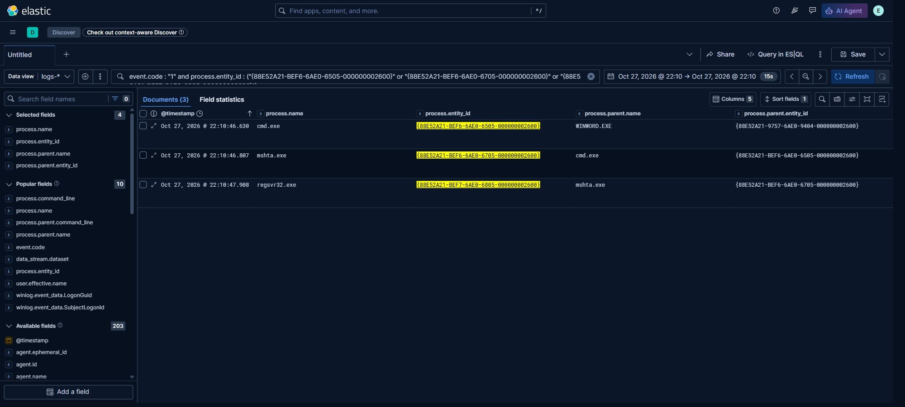
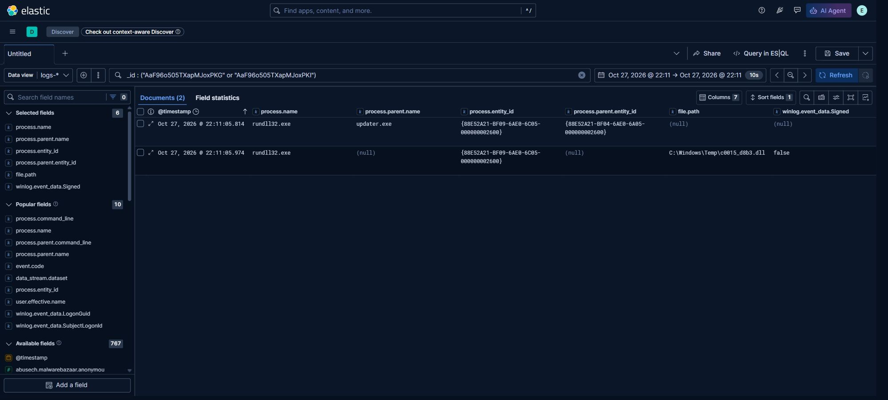

# Case: Office to loader

**Bundle** [`evidence/runs/run-1/`](../../evidence/runs/run-1/run.json), capture `cap-run1-2`.
**Alerts** four documents: R01 at 12:22:13Z, R02 at 12:22:16Z, R03 twice at 12:22:19Z.

The investigation starts from the alerts, resolves their source events by index and id, and then asks
what those events actually connect.

## 1. Source events, by alert

Each row is a document referenced by an alert; `alert` is the alert `_id` prefix, `source` the document
`_id`. Entity ids are Sysmon `ProcessGuid` values, abbreviated to the parts that matter.

| # | Alert | Source | UTC | Process (entity) | Parent (entity) | Command line / file |
|---|---|---|---|---|---|---|
| 1 | R01 `11181ec86fe7` | `AaF9T4505TXapMFDnV4y` | 12:21:47.263 | `cmd.exe` `…-975B-…-9504` | `WINWORD.EXE` `…-9757-…-9404` | `cmd.exe /c mshta "C:\Users\duc.user\compareforfor.hta"` |
| 2 | R02 `037457061001` | `AaF9T4505TXapMFqnWWP` | 12:21:48.568 | `regsvr32.exe` `…-975C-…-9A04` | `mshta.exe` `…-975B-…-9704` | `regsvr32.exe C:\Users\Public\compareForfor.jpg` |
| 3 | R03 `6d0d0b427690` | `AaF9T4505TXapMFqnWWV` | 12:21:48.802 | `regsvr32.exe` `…-975C-…-9A04` | not carried by E7 | module `C:\Users\Public\compareForfor.jpg`, `Signed=false` |
| 4 | R03 `022fa9b857d4` | `AaF9T4505TXapMGSnkEd` | 12:22:04.962 | `rundll32.exe` `…-976C-…-9E04` | not carried by E7 | module `C:\Windows\Temp\c0015_d8b3.dll`, `Signed=false` |

## 2. What the joins prove

Events 1 to 3 are one chain, and the identity is explicit rather than inferred from time:

- event 1 names `WINWORD.EXE` as the parent of `cmd.exe`;
- event 2 names `mshta.exe` as the parent of `regsvr32.exe`, and that `mshta.exe` entity id
  (`…-975B-…-9704`) is the process started by the `cmd.exe` in event 1;
- event 3 carries the same process entity id as event 2 (`…-975C-…-9A04`), so the unsigned module was
  loaded by that exact `regsvr32.exe` instance.

So: **a Word process started a shell, the shell started `mshta`, `mshta` started `regsvr32`, and that
`regsvr32` loaded an unsigned `.jpg` as a module.**

## 3. Bridging events in the entity context

The bundle's `context/` queries by entity id, and two of them close the gaps above. They are **context
documents, not alert sources**, so they carry their own locators.

| UTC | Locator | Process (entity) | Parent (entity) |
|---|---|---|---|
| 12:21:47.317 | `AaF9T4505TXapMFDnV41` | `mshta.exe` `…-975B-…-9704` | `cmd.exe` `…-975B-…-9504` |
| 12:22:04.810 | `AaF9T4505TXapMGSnkEc` | `rundll32.exe` `…-976C-…-9E04` | `updater.exe` `…-9769-…-9C04` |

- The first row names the `cmd.exe` entity from event 1 as the parent of the `mshta.exe` entity that
  event 2 names. That is the missing identity edge: **Word → `cmd` → `mshta` → `regsvr32` → unsigned
  module** is now connected by entity ids, not by timing.
- The second row names `updater.exe` as the parent of the `rundll32.exe` in event 4, so the second module
  is loaded by a **separate branch** started by the SYSTEM stager, not by `regsvr32`.

## 4. What is not proven

Event 4 belongs to a second branch. With the context row above, its parent is `updater.exe`, the SYSTEM
stager, not `regsvr32`. What remains unproven is the link between the document and that stager: the
scheduled task that ran `updater.exe` is not in this bundle.

- **proven:** Word → `cmd` → `mshta` → `regsvr32` → unsigned module; and `updater.exe` → `rundll32` →
  unsigned module;
- **not proven here:** that the document started `updater.exe` (needs the task creation event).

| Claim | Status |
|---|---|
| A Word process started a shell | Proven by event 1 |
| The shell started `mshta` | Proven by event 1 command line and event 2 parent name |
| `mshta` started `regsvr32` | Proven by event 2 parent entity id |
| `regsvr32` loaded an unsigned module | Proven by event 3, same entity id |
| `rundll32` was started by `updater.exe` | Proven by the context document |
| The document started `updater.exe` | **Not proven** |
| Network activity or C2 | Not in this bundle |

## 4. Timing

Event 1 to event 2 is **1.305 s**; event 2 to event 3 is **0.234 s**; event 3 to event 4 is **16.16 s**.

## 5. Disposition

Investigate, priority high. The proven chain reaches proxy execution with an unsigned module from a
user-writable path. Next: find the process-creation event for the `rundll32.exe` in event 4 and any
network event from `ws01` around 12:22Z.

## 6. Operator ground truth

The lab builds this chain from a document macro; the operator knows the HTA path and that the `.jpg` is a
loader stub. None of that is in the events above, and the case is written to stand without it.

## Evidence

