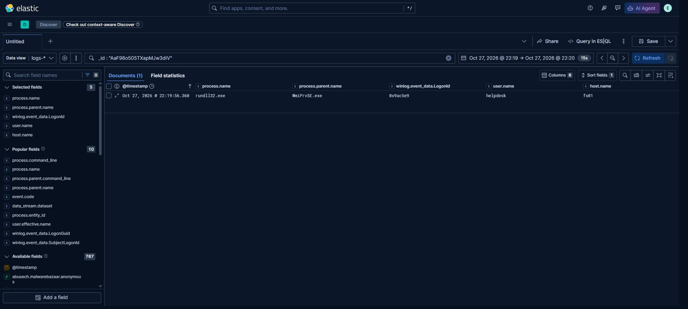

# Case: WMI lateral execution

**Alerts** `C0015 | wmi remote creation` (source side, five documents) and `C0015 | wmi loader execution` /
`C0015 | wmi shell execution` (target side), 2026-10-27T12:27:03Z - 12:27:24Z.
**Bundle** [`evidence/runs/run-1/`](../../evidence/runs/run-1/run.json).

## 1. Source side (`ws01`)

| UTC | Locator | Command line (redacted) |
|---|---|---|
| 12:27:03.270 | `AaF9VI505TXapMElq26Z` | `wmic /node:FS01 /user:C0015\helpdesk /password:*** process call create "rundll32.exe C:\ProgramData\143.dll DllRegisterServer"` |
| 12:27:06.478 | `AaF9VI505TXapMElq27j` | `wmic ... process call create "powershell.exe -NoProfile -Command Set-MpPreference ..."` |
| 12:27:09.889 | `AaF9VI505TXapMFMrXYV` | `wmic ... process call create "C:\ProgramData\inject.cmd"` |
| 12:27:19.001 | `AaF9VI505TXapMFyrcL7` | `wmic ... process call create "C:\ProgramData\dump.cmd"` |
| 12:27:24.446 | `AaF9VI505TXapMFyrsI5` | `wmic ... process call create "cmd.exe /c C:\locker.bat"` |

All five run as `SYSTEM` under a `cmd.exe` parent, and every command line carries the same account.

## 2. Target side (`fs01`)

| UTC | Locator | Process | Parent |
|---|---|---|---|
| 12:27:03.387 | `AaF9VI505TXapMEVqvrh` | `rundll32.exe C:\ProgramData\143.dll DllRegisterServer` | `WmiPrvSE.exe` |
| 12:27:06.571 | `AaF9VI505TXapMFBrF1u` | `powershell.exe -NoProfile -Command Set-MpPreference ...` | `WmiPrvSE.exe` |
| 12:27:09.979 | `AaF9VI505TXapMFBrF2t` | `cmd.exe /c C:\ProgramData\inject.cmd` | `WmiPrvSE.exe` |
| 12:27:19.109 | `AaF9VI505TXapMFlrcSd` | `cmd.exe /c C:\ProgramData\dump.cmd` | `WmiPrvSE.exe` |
| 12:27:24.535 | `AaF9VI505TXapMGMriKM` | `cmd.exe /c C:\locker.bat` | `WmiPrvSE.exe` |

All five run as `C0015\helpdesk`.

## 3. Logon bridge on the target

The target side is tied to an authentication event, not only to timing.

| Field | Value |
|---|---|
| Event | `4624` at 12:27:03.363Z on `fs01` |
| Locator | `.ds-logs-system.security-c0015-2026.10.24-000002` / `AaF9VI505TXapMEVq_ob` |
| Account | `C0015\helpdesk` |
| Logon type | `3` (network) |
| Authentication | Kerberos |
| `TargetLogonId` | `0xad3a88` |

The `rundll32.exe` created under `WmiPrvSE.exe` at 12:27:03.387Z carries `winlog.event_data.LogonId =
0xad3a88` - the same logon id, 24 ms later. On `fs01`, the WMI child process and that logon are the same
session.

What this does **not** do is prove the path from `ws01`: the logon id is per host, and the bundle has no
source-side network or authentication event tying that session to the `wmic` invocation on `ws01`.

## 4. What the pair proves

The source and target documents agree on account, command content and sub-second timing, and the target
side is bound to logon `0xad3a88`. That is stronger than time correlation on `fs01`.

It still does not prove the path from `ws01`: no source-side authentication or network record links the
`wmic` invocation to that logon id, so the cross-host step is a correlation by account, content and time.

## 4. Disposition

High priority, escalate. WMI used with explicit credentials to run a loader, disable defences, inject,
dump and execute an impact file is a coherent intrusion path, and the account is a helpdesk identity
that should not be performing it.

## 5. Limits

- The target logon is confirmed (`4624`, type 3, Kerberos); the source-side record of that session is not in the bundle.
- The password is redacted in the export; the original document retains it in the lab only.

## Evidence

