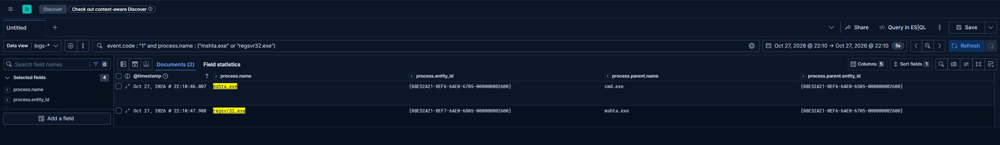

# HTA proxy execution

`mshta.exe` runs the HTML Application written by the macro. The HTA mixes VBScript and JScript,
decodes a base64 blob, and fetches the next stage over HTTP with `MSXML2.XMLHTTP`. The response body
is written with `ADODB.Stream` to `C:\Users\Public\compareForfor.jpg` and executed through
`WScript.Shell`: `regsvr32.exe` is started with the `.jpg` path as its only argument.

The extension mismatch is the point. The file is a PE image, the extension is an image file, and the
process that loads it is a signed Windows binary.

## How the lab reproduces it

`payload/compareforfor.hta` keeps the three COM objects, the base64 decode path (`Msxml2.DOMDocument`
with `bin.base64`), the HTTP download, and the `regsvr32` invocation. Paths and the staging host come
from `config.ini`, so the HTA carries no lab constants.

The HTA is written by the macro at open time rather than shipped alongside the document, which
preserves the `E11` file-creation event on the victim host.

## Artifacts

| File | Purpose |
|---|---|
| `payload/compareforfor.hta` | Stage-2 HTML Application |

## Telemetry and detection

The rule for this behaviour lives in [`detections/eql/`](../../detections/eql/) and is listed in the index at [`detections/README.md`](../../detections/README.md). The field assumptions the rule depends on are recorded there.

## Evidence

