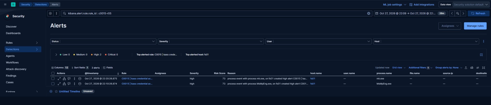
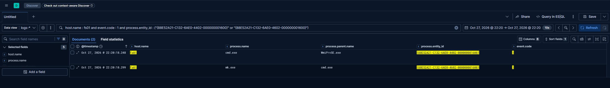
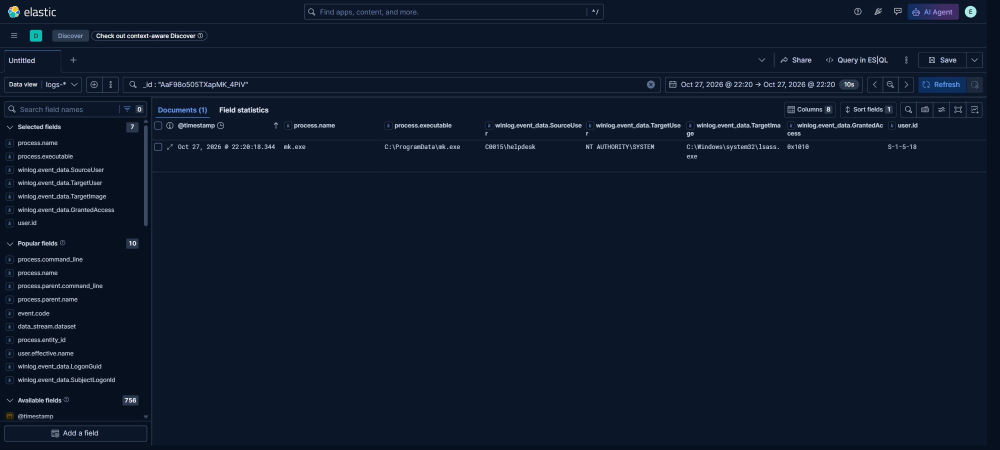

# LSASS access through ProcessHacker

ProcessHacker is dropped in the root of `C:` and started from the RDP session. The tool is used to
open `lsass.exe` and write a memory dump. The report records the process access and the tool
placement, and states that the dump is likely but not confirmed; no credential material was recovered
in the source investigation.

The access mask is the discriminating field. A tool that opens `lsass.exe` with query rights only
produces a low-value event; a tool that reads process memory produces a mask containing
`PROCESS_VM_READ` and is the pattern worth alerting on.

## How the lab reproduces it

The lab performs the confirmed part literally and the uncertain part explicitly:

1. ProcessHacker is placed at `C:\ProcessHacker.exe` and started from the interactive session.
2. A dump of `lsass.exe` is written to `C:\ProgramData\lsass.dmp`.
3. The dump is parsed offline with Mimikatz (`sekurlsa::minidump`), so the credential material is
   produced by the tool the operator would use, not by the dumper.

Both the access and the dump are recorded, which closes the gap left by the source report. Credential
material stays in the run and is never written to the repository; the dump is deleted at the end of
the run.

`tools/processhacker-dump.md` lists the GUI steps and the expected event fields.
`tools/mimikatz-minidump.txt` records the offline parsing command.

## Artifacts

| File | Purpose |
|---|---|
| `tools/processhacker-dump.md` | GUI dump procedure and event expectations |
| `tools/mimikatz-minidump.txt` | Offline parsing of the dump |

## Telemetry and detection

The rule for this behaviour lives in [`detections/eql/`](../../detections/eql/) and is listed in the index at [`detections/README.md`](../../detections/README.md). The field assumptions the rule depends on are recorded there.

## Evidence

## Credential path used for the pivot

`tools/c0015_prep.ps1` prepares the host: it enables `SeDebugPrivilege` in the calling process, clears
`RunAsPPL` when set, adds Defender exclusions and disables real-time monitoring, and sets
`LocalAccountTokenFilterPolicy`. It writes `C:\ProgramData\c0015-prep.txt`.

The credential used for lateral movement is obtained, not provisioned:

1. `bk.admin` is a member of the local Administrators group on the backup server and holds a session
   there (a scheduled task started with `/ru C0015\bk.admin`), so its material is in LSASS.
2. `mimikatz.exe "privilege::debug" "sekurlsa::logonpasswords"` runs on the backup server and yields
   the NT hash.
3. From the beachhead, `sekurlsa::pth /user:bk.admin /domain:C0015 /ntlm:<hash> /run:<script>` starts a
   process with the forged logon session; the script runs `wmic /node:FS01 ...` through it.

Observed telemetry: `E10` from `mimikatz.exe` to `lsass.exe` with `GrantedAccess 0x1010`, `E1` with the
full mimikatz command line, then `4624` type 3 with `AuthenticationPackageName: NTLM` and
`WorkstationName: WS01`, plus `4672` for the same account. No plaintext password is used at any point
after the dump.
